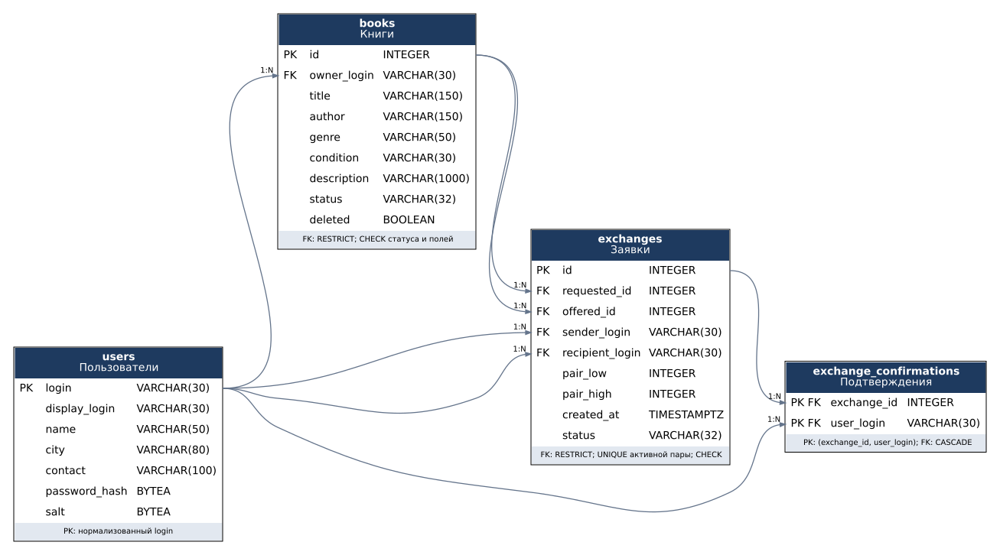

# Схема данных

## Таблицы и ключи

| Таблица | Первичный ключ | Внешние ключи и назначение |
|---|---|---|
| `users` | `login` | Учётная запись. Ключ в нижнем регистре; `display_login` сохраняет написание пользователя |
| `books` | `id` | `owner_login → users.login`, один экземпляр книги и признак скрытого объявления |
| `exchanges` | `id` | `requested_id`, `offered_id → books.id`; `sender_login`, `recipient_login → users.login` |
| `exchange_confirmations` | `(exchange_id, user_login)` | `exchange_id → exchanges.id`, `user_login → users.login` |

`users → books` — связь 1:N: у пользователя несколько книг, у каждой книги один
владелец. Также есть две связи 1:N между пользователями и заявками (отправитель,
получатель) и две между книгами и заявками (запрошенная, предложенная).
Все парные ORM-связи используют `relationship` с `back_populates`.

`users ↔ exchanges` через `exchange_confirmations` — M:N: пользователь подтверждает
разные обмены, у обмена несколько подтвердивших пользователей. Составной PK
исключает повторное подтверждение одним человеком. Правила сервиса ограничивают
подтверждения двумя участниками принятой заявки; сама M:N-связь отражает факт
подтверждения, а не список всех заявок пользователя.

## Ограничения

- У каждого столбца задан тип; обязательные поля не допускают `NULL`.
- PK уникален во всех таблицах. ID книги и заявки выдаются автоматически.
- Длины и непустые строки, допустимые жанры, состояния и статусы защищены `CHECK`.
  Формат логина, пароль и права участников дополнительно проверяются сервисами.
- В заявке требуются разные книги и разные участники.
- `pair_low` и `pair_high` — упорядоченные ID двух книг. `CHECK` связывает их
  с `requested_id` и `offered_id`, поэтому обратная заявка имеет ту же пару.
- Частичный уникальный индекс `uq_exchanges_active_pair` запрещает вторую заявку
  на ту же пару в статусе «Ожидает ответа» или «Принята». Закрытые заявки не мешают
  создать новое предложение. Индекс задан для PostgreSQL и SQLite.
- FK проверяют существование владельцев, участников и книг. `RESTRICT` защищает
  записи истории от физического удаления. Объявления скрываются флагом `deleted`.
- Только FK таблицы подтверждений имеют `ON DELETE CASCADE`: удаляются связи,
  а не книги и участники. В ORM нет каскада `delete` между основными сущностями.

Совпадение владельцев книг с участниками заявки, допустимые переходы статусов
и резервирование выполняет `ExchangeService` в общей транзакции. Эти правила
нельзя заменить проверкой одного столбца. Для конкурентных изменений PostgreSQL
используется `SERIALIZABLE`; повтор активной пары дополнительно защищён индексом.

Названия всех ограничений и полные определения столбцов находятся в
`src/database/models.py` и начальной ревизии `migrations/versions/`.
